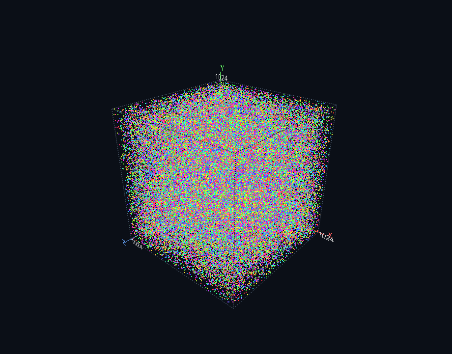
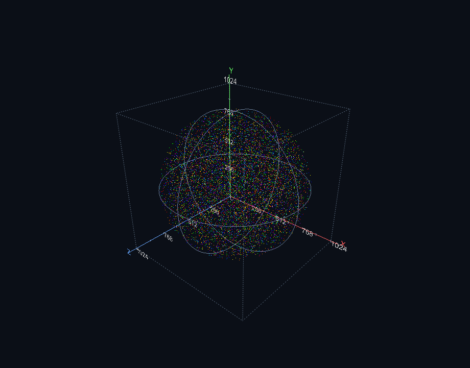
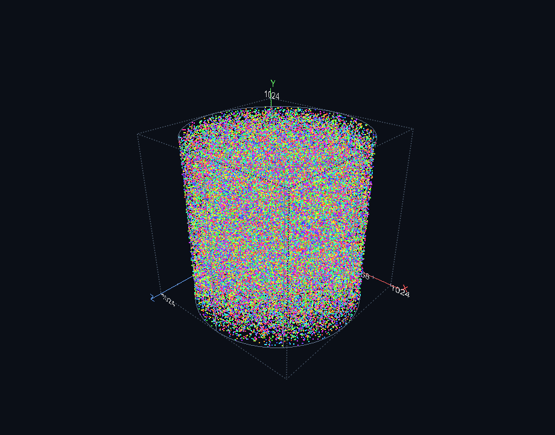
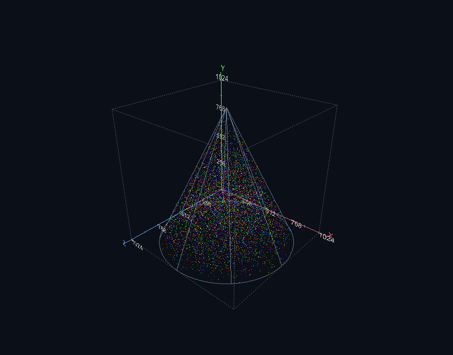

# Лабораторная №1. Равномерное распределение точек

C++Builder + VCL + GLScene. Генерация 100 000 точек или сфер в кубе, сфере,
цилиндре и конусе. Камера снаружи и в центре, оси XYZ, случайное время свечения
1–100 секунд и измерение FPS.

## Примеры работы

100 000 точек в кубе.

Сферы случайного радиуса и семи цветов в сферическом контейнере.

Равномерное распределение точек в цилиндре.

Сферы в коническом контейнере.

## FPS

Таблица №2. FPS навигатора TGLSimpleNavigation (GLSimpleNavigator).

Замер: 100 000 объектов, 5 секунд прогрева и 10 секунд измерения;
свечение приостановлено. Область вывода — 920 × 721 пиксель, VSync выключен.

| Контейнер | Объекты | Камера снаружи | Камера в центре |
| --- | --- | ---: | ---: |
| Куб | Точки | 1173,4 | 1193,8 |
| Куб | Сферы | 5,9 | 6,2 |
| Сфера | Точки | 1216,8 | 1237,0 |
| Сфера | Сферы | 5,8 | 5,9 |
| Цилиндр | Точки | 1337,3 | 1354,2 |
| Цилиндр | Сферы | 6,2 | 6,6 |
| Конус | Точки | 1353,9 | 1335,9 |
| Конус | Сферы | 6,1 | 6,0 |

Примеры для изучения: [AstrobloQ](https://github.com/glscene/AstrobloQ).
